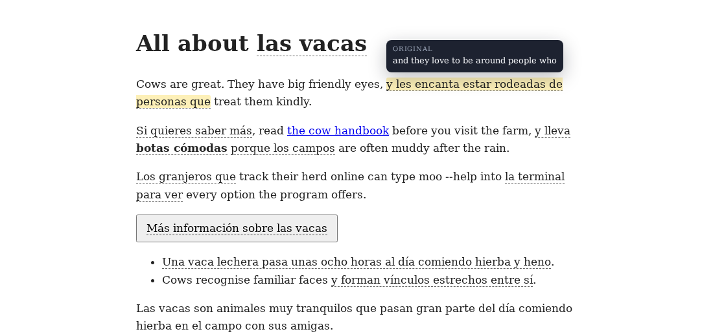
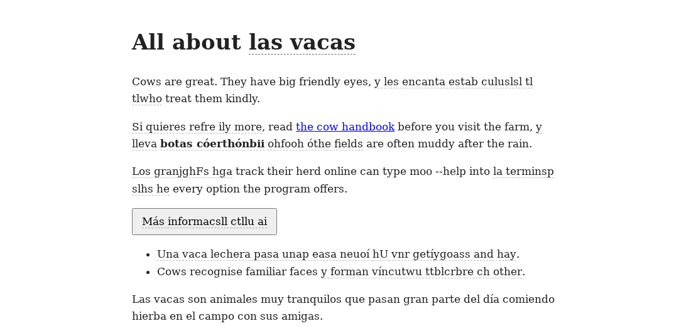
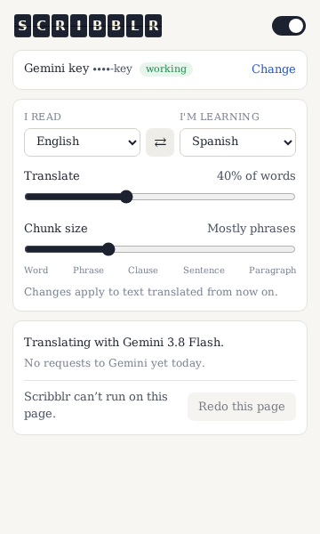

# Scribblr

A Chrome extension for learning a language while you browse. On every page you read, Scribblr
translates part of the text into the language you're learning. Each translated chunk flips into
place like a split-flap departure board and is marked with a dashed underline. Hover over a chunk
to see the original text.

- **You choose how much and how big.** One slider sets the share of words to translate. The other
  sets the typical chunk size, from single words to whole paragraphs; chunks come in a mix of
  sizes around that setting.
- **Translations are context-aware.** Gemini sees the whole page, with the chunks to translate
  marked, so it can pick the right meaning, gender and tense.
- **It works on live pages.** Text added after the page loads is translated too: infinite feeds,
  single-page apps, live chats, and AI replies that stream in word by word (Scribblr waits until a
  reply has finished).
- **It's careful with the page.** Links keep working, and editors, text fields, code and text in
  other languages are left alone.
- **It's frugal with the free tier.** Usually about two Gemini requests per page. Reloads are
  served from a cache, and the selection reshuffles once a day. When a model's daily quota runs
  out, Scribblr moves on to the next free model, and it pauses when it hits a rate limit.







## Install: Windows (with WSL)

You build Scribblr inside WSL with Nix and load the result into Chrome on Windows. You need
Chrome and about 2.5 GB of free disk space for the build tools.

1. **Install WSL.** Open PowerShell as Administrator and run `wsl --install`, then restart Windows.
   Open **Ubuntu** from the Start menu and create a user when it asks.

2. **Install Nix** in the Ubuntu terminal:

   ```sh
   sudo apt-get update && sudo apt-get install -y git curl xz-utils
   sh <(curl --proto '=https' --tlsv1.2 -L https://nixos.org/nix/install) --no-daemon
   ```

   Close the terminal and open a new one so the `nix` command is available.

3. **Get the code:**

   ```sh
   git clone https://github.com/levavakian/scribblr.git ~/scribblr
   cd ~/scribblr
   ```

4. **Build the extension and copy it to Windows:**

   ```sh
   ./shell.sh -c "npm run install:windows"
   ```

   The first run downloads Node.js, Chromium (for the tests) and the npm packages, which takes a
   few minutes. At the end it prints the Windows folder it copied the extension to, normally
   `C:\Users\<you>\scribblr-extension`. To use another folder, set `SCRIBBLR_WINDOWS_DIR` to its
   WSL path first, e.g. `SCRIBBLR_WINDOWS_DIR=/mnt/d/scribblr ./shell.sh -c "npm run install:windows"`.

5. **Load it into Chrome:** go to `chrome://extensions`, switch on **Developer mode** (top right),
   click **Load unpacked**, and pick the folder from step 4.

6. **Set it up:** a Scribblr settings tab opens on its own. Paste a Gemini API key (see below) and
   choose the language you read and the one you're learning. Pin Scribblr from the puzzle-piece
   menu so its popup is one click away.

**Updating:** `cd ~/scribblr && git pull && ./shell.sh -c "npm run install:windows"`, then click
the reload icon on Scribblr's card in `chrome://extensions`.

## Install: Linux or macOS

1. Install Nix: `sh <(curl --proto '=https' --tlsv1.2 -L https://nixos.org/nix/install)`, then
   open a new terminal.
2. `git clone https://github.com/levavakian/scribblr.git && cd scribblr`
3. `./shell.sh -c "npm run build"` puts the extension in `dist/`.
4. In Chrome: `chrome://extensions` → **Developer mode** → **Load unpacked** → choose `dist/`.
5. Follow step 6 above. After updating and rebuilding, click reload on Scribblr's card.

## Getting a Gemini API key

Create a key at <https://aistudio.google.com/apikey> and paste it into Scribblr's popup.
Scribblr checks the key with one tiny request before saving it.

- **Free tier:** keys belong to Google Cloud projects, and only projects with **no billing account
  linked** get the free tier. A key from a billed project works too, but each request costs money.
  When its prepaid credits or monthly spend cap run out, requests fail; Scribblr then stops and
  shows what to change in AI Studio (aistudio.google.com/spend for the cap).
- **Limits:** Google shows your exact limits in AI Studio. At the time of writing, the free tier
  allows about 20 requests a day for each recent Flash model and about 500 a day for Flash-Lite
  models. Scribblr starts each day on the newest Flash model. When a model's daily quota is used
  up, it moves to the next one: older Flash models first, then Flash-Lite. Once every model is
  used up, it pauses until the first one resets, at the time Google gives in its error. If it hits a per-minute
  limit, it pauses for as long as Google asks. While paused, the toolbar icon shows `||`, and
  already-cached translations still appear.
- **Privacy:** Scribblr sends the text of the pages you visit to Google's Gemini API. Google may use
  free-tier requests to improve its products. Turn Scribblr off on sites you'd rather keep private
  with the **Translate on this site** switch in the popup.

## Using it

- **Popup:** the master switch, a per-site switch, your languages, the two sliders, which model is
  in use, today's request count, and any pause or error. Settings apply to text translated from
  then on; **Redo this page** re-applies them to the current page.
- **Models** (in the popup): every Gemini Flash and Flash-Lite model your key can use, in the
  order Scribblr tries them. Switch models on or off and move them up or down. Scribblr uses the
  first model that's on and still has quota, moving down the list as each runs out. The default
  order is newest Flash first; new releases join it on their own, or go at the end of a custom
  order. Preview models are off by default; each has its own free quota, so switching them on adds
  capacity. Each row shows its requests today and when a used-up model is available again.
- **Hover** a translated chunk to see the original.
- Only text that Chrome's built-in language detection identifies as the language you read gets
  translated, so pages and posts in other languages stay as they are.

Not handled yet:

- Text inside iframes, such as embedded posts and YouTube's live-chat panel. Only the main page
  is translated.
- Text inside shadow DOM components.
- Text that is already in the page but hidden, and later revealed by a CSS class change rather
  than by adding it to the page.

## Development

Everything runs inside the Nix environment, which provides Node.js 24 and, on Linux, Chromium for
the end-to-end tests:

```sh
./shell.sh                        # an interactive shell with the tools on PATH
./shell.sh -c <command…>          # run one command in it, e.g. ./shell.sh -c npm test
```

npm dependencies are installed automatically on first use. Inside the shell:

| Command | What it does |
| --- | --- |
| `npm run build` | Build the extension into `dist/` (`-- --out <dir>` to build elsewhere) |
| `npm run watch` | Rebuild on every change (then reload the extension in Chrome) |
| `npm run install:windows` | From WSL: build and copy to a Windows folder |
| `npm test` | Type-check and run the unit tests |
| `npm run test:e2e` | Build, then run the end-to-end tests: the real extension in headless Chromium against a mock Gemini API (Linux only) |
| `npm run test:live` | Check prompts against the real Gemini API. Needs `GEMINI_API_KEY`; spends one request on a Flash-Lite model (set `LIVE_MODEL` to pick another) |
| `LIVE_E2E=1 npx playwright test live` | The whole extension against the real API (needs `GEMINI_API_KEY`; about 3 requests) |
| `npm run icons` | Redraw the icons in `src/icons/` |

### How it works

- `src/content/`: the content script.
  - `scan.ts` splits the page into runs of text, one per block element: paragraph, list item,
    button, chat message.
  - `segment.ts` and `plan.ts` choose the chunks for each run, seeded so the choice is stable for
    a day.
  - `page.ts` watches for new and changing text and waits until it stops changing. It sends one
    request for what's on screen and one for the rest of the page, then batches anything that
    arrives later.
  - `apply.ts` puts translations into the page without moving or removing any of the page's own
    nodes. Pages built with React and similar frameworks keep working, and when such a page
    rewrites text it owns, Scribblr undoes its changes and translates the new text.
  - `animate.ts` is the split-flap effect; `tooltip.ts` shows the original on hover.
- `src/background/`: the service worker.
  - Serves cached translations from IndexedDB.
  - Builds the prompt: the page as context, chunks marked, structured JSON output.
  - Calls Gemini, working through the model chain and the daily and per-minute limits.
- `src/popup/`: the popup, which also serves as the settings page.
- `test/unit` (Vitest), `test/e2e` (Playwright + `mock-gemini.ts`), `test/live` (real API).
